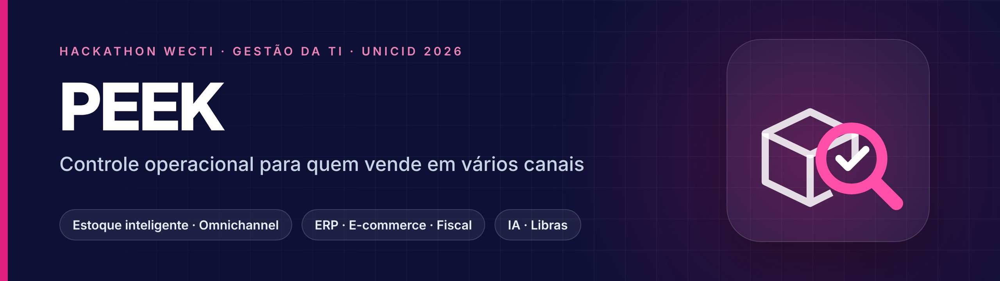
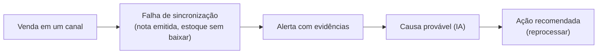
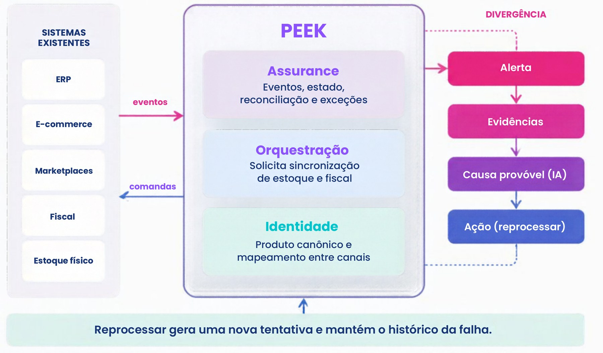

<div align="center">



# PEEK

### Controle operacional para quem vende em vários canais

**Hackathon WECTI 2026** · Equipe PEEK · 2º semestre · UNICID 2026

<sub>Dor 1: Estoque Inteligente & Omnichannel · Trabalho em equipe</sub>

[](docs/PEEK_Hackathon_WECTI.pdf)

[](https://github.com/novaishenrique/projeto-PEEK/actions/workflows/ci.yml)


</div>

---

## Sumário

- [Sobre o projeto](#sobre-o-projeto)
- [Funcionalidades](#funcionalidades)
- [Modos de uso](#modos-de-uso)
- [Arquitetura](#arquitetura)
- [Tecnologias](#tecnologias)
- [Modelo de negócio](#modelo-de-negócio)
- [Próximos passos](#próximos-passos)
- [Estrutura do repositório](#estrutura-do-repositório)
- [Como executar](#como-executar)
- [Equipe](#equipe)

---

## Sobre o projeto

### O problema

> **A nota saiu. O estoque não baixou. E o cliente já comprou.**

Pequenas e médias empresas do varejo vendem ao mesmo tempo na loja, no e-commerce e em marketplaces, cada canal com o seu sistema. Quando uma integração falha, ninguém percebe até o cliente reclamar.

| Dado | O que significa |
|:---:|---|
| **24 mi** | pequenos negócios ativos no Brasil (Sebrae, Radar Mercado Digital 2026) |
| **59,2%** | das operações de e-commerce dos pequenos negócios são tocadas por uma só pessoa (Sebrae) |
| **> 50%** | dos vendedores online também têm loja física (Sebrae) |
| **R$ 36,5 bi** | em perdas no varejo em 2024 (Abrappe/KPMG) |
| **42%** | das perdas de vendas vêm de ruptura de estoque (AGP/Abras) |

**Onde a operação falha:** produto com vários códigos em sistemas diferentes, estoque desatualizado entre canais, nota fiscal fora do estoque e falhas descobertas tarde, só pelo cliente.

### A solução

O **PEEK** é uma camada de controle operacional sobre os sistemas que a empresa já usa. Ele observa ERP, e-commerce, marketplaces e fiscal, compara o que **deveria** acontecer com o que os sistemas **relatam** e mostra as divergências com evidências para investigar. **Não substitui o ERP:** cada sistema continua responsável pelas suas transações.

O projeto nasceu no **Hackathon WECTI 2026** da UNICID, na **Dor 1: Estoque Inteligente & Omnichannel**.

---

## Funcionalidades

| Funcionalidade | O que faz |
|---|---|
| **Identidade do produto** | Reconhece o mesmo produto entre ERP, canais e loja (produto canônico e mapeamento entre canais). |
| **Orquestração** | Solicita a sincronização de estoque e o fluxo fiscal nos sistemas existentes. |
| **Verificação** | Confere se o resultado esperado realmente aconteceu: não basta integrar, é preciso comprovar. |
| **Central de Exceções** | Reúne as divergências em alertas, cada um com evidências, causa provável e próxima ação. |
| **Causa provável com IA** | A IA entra só onde há ambiguidade, para explicar a causa e recomendar a ação. |
| **Reprocessar** | Gera uma nova tentativa e mantém o histórico da falha para auditoria. |
| **Acessível em Libras** | Pensado para incluir lojistas e equipes surdas, com alertas e orientações acessíveis. |

**Exemplo:** a venda gera a nota fiscal, mas o estoque não baixa no e-commerce. O PEEK detecta a divergência, abre um alerta com as evidências (nota emitida, estoque sem baixa), aponta a causa provável e recomenda reprocessar a sincronização.



---

## Modos de uso

| Modo | Para que serve | Limites |
|---|---|---|
| **Demo** | Apresentação do hackathon: produtos e mapeamentos mínimos, eventos com as quatro exceções (E01 a E04), investigação dos alertas e comandos, tentativas e propagação simulados. O agente de IA (Jev, via MCP) é opcional. | Só dados fictícios; efeitos externos simulados. |
| **Piloto** | Uso com empresas: organização e sessão, empresas, conexões e permissões, evidências e configuração, obrigações, avaliações e gestão de casos. | Somente leitura dos sistemas do cliente, banco de dados próprio e sem escrita externa. |

---

## Arquitetura

Os sistemas existentes enviam **eventos** ao PEEK, que devolve **comandos** de sincronização. Quando o resultado esperado não acontece, a divergência vira um alerta com evidências, causa provável e ação.

<p align="center">
  
</p>

| Camada | Componente | Papel |
|:---:|---|---|
| **1** | **Adapters** | Traduzem ERP, canais e fiscal para o formato do PEEK |
| **2** | **Event Engine** | Eventos canônicos e auditáveis |
| **3** | **PostgreSQL** | Estado esperado, do sistema e físico |
| **4** | **Reconciliação** | Regras determinísticas e as quatro exceções |
| **5** | **IA do PEEK** | Causa provável e ação recomendada |
| **6** | **Central de Exceções** | Alerta, evidências e ação |

No hackathon, as fontes de dados são **simuladas**, seguindo o mesmo pipeline da arquitetura real.

---

## Tecnologias

| Parte | Tecnologia | Para que serve |
|---|---|---|
| **Back-end** | Java 21 e Spring Boot (monólito modular), Maven 3.9 | Adapters, Event Engine, reconciliação e API |
| **Banco de dados** | PostgreSQL 16, JPA/Hibernate e Flyway | Estado esperado, do sistema e físico, com migrações versionadas |
| **Front-end** | Next.js, TypeScript e Tailwind CSS (Node 22) | Central de Exceções e jornadas de investigação |
| **IA** | Agente Jev conectado por MCP | Causa provável e ação recomendada |
| **Infraestrutura** | Docker Compose e GitHub Actions | Banco local para a demo e testes a cada push |

---

## Modelo de negócio

| Aquisição | Monetização | Público |
|---|---|---|
| **Cold email** para PMEs varejistas multicanal, com a dor concreta: nota emitida, estoque sem baixar. | **Consultoria e implantação** personalizadas, com base na empresa, como porta de entrada. | **PME varejista multicanal:** dono ou gestor que vende em loja, e-commerce e marketplaces. |
| **Diagnóstico** de onde ERP, canais e fiscal divergem hoje, seguido da **implantação do PEEK**. | Faixa de **R$ 129,99 a R$ 329,99**, conforme o porte da empresa e a consultoria. | **24 milhões** de pequenos negócios ativos no Brasil (Sebrae). |

---

## Próximos passos

| Etapa | O que é |
|---|---|
| **01 · Agora** | MVP do hackathon: fontes simuladas, eventos canônicos, quatro exceções e Central de Exceções, com IA para causa e ação. |
| **02 · Próximo passo** | Incorporar RAG (embeddings e chunks) ao PEEK. |
| **03 · Depois** | Pilotos com PMEs: validar com lojistas reais, priorizar ERPs e canais e medir o ganho antes de prometer resultado. |

---

## Estrutura do repositório

```
.
├── docs/
│   └── PEEK_Hackathon_WECTI.pdf   ← documentação do projeto (problema, solução, arquitetura e negócio)
├── imagens/
│   └── arquitetura.jpg            ← diagrama da arquitetura usado neste README
├── .github/
│   ├── capa.jpg                   ← capa deste README
│   ├── tests/repo.test.js         ← testes automáticos
│   └── workflows/ci.yml           ← roda os testes a cada push
└── README.md
```

O código do PEEK está organizado assim no repositório da equipe:

```
backend/src/main/java/io/peek/core/
├── providers/      ← integração com cada sistema (semântica e transporte)
├── pilot/          ← organização, configuração, admissão, persistência e orquestração
└── observation/    ← algoritmos de observação e reconciliação
backend/src/test/   ← testes unitários e de integração com PostgreSQL e HTTP
frontend/           ← interface, contratos tipados e jornadas no navegador
docs/               ← contratos, decisões e operação
scripts/            ← testes e utilitários locais com dados fictícios
compose.yaml        ← PostgreSQL local
```

---

## Como executar

A demonstração roda com dados fictícios, a partir da raiz do código do PEEK. Precisa de Java 21, Maven 3.9, Node 22 e Docker.

**1. Banco de dados e back-end**

```bash
docker compose up -d postgres
cd backend
mvn package
SPRING_PROFILES_ACTIVE=demo mvn spring-boot:run
```

A saúde da API fica em `/actuator/health`.

**2. Front-end** (em outro terminal)

```bash
cd frontend
npm ci
cp .env.example .env.local
NEXT_PUBLIC_DEMO=1 npm run dev
```

Abra `http://localhost:3000`. O modo demo usa somente dados fictícios; nunca use dados de cliente nele.

**Testes deste repositório** (Node 20 ou mais novo):

```bash
node --test .github/tests/*.test.js
```

Eles conferem os links e as imagens do README e se a documentação em PDF está no repositório.

---

## Equipe

| Integrante |
|---|
| Cauã Francisco Gomes da Silva |
| César Augusto Mechi Zanin |
| Henrique Novais de Oliveira |
| João Pedro Liberato de Oliveira |
| Júlio César Pereira da Silva |
| Marcus Vinicius dos Santos Cruz |
| Mateus Alves dos Santos |

---

<div align="center">

<sub>PEEK · Hackathon WECTI 2026 · Gestão da Tecnologia da Informação · UNICID 2026</sub>

</div>
