<div align="center">


# PEEK

### Controle operacional para quem vende em vários canais

**Hackathon WECTI 2026** · Equipe PEEK · 2º semestre · UNICID 2026

<sub>Dor 1: Estoque Inteligente & Omnichannel · Pitch de 10 minutos · Trabalho em equipe</sub>

[](docs/PEEK_Hackathon_WECTI.pdf)

[](https://github.com/novaishenrique/projeto-PEEK/actions/workflows/ci.yml)


</div>

---

## Sumário

- [Sobre o projeto](#sobre-o-projeto)
- [O problema](#o-problema)
- [A solução](#a-solução)
- [Demonstração](#demonstração)
- [Arquitetura e stack](#arquitetura-e-stack)
- [Modelo de negócio](#modelo-de-negócio)
- [Próximos passos](#próximos-passos)
- [Apresentação](#apresentação)
- [Estrutura do repositório](#estrutura-do-repositório)
- [Código-fonte](#código-fonte)
- [Equipe](#equipe)

---

## Sobre o projeto

> **A nota saiu. O estoque não baixou. E o cliente já comprou.**

O **PEEK** é uma camada de controle operacional para pequenas e médias empresas do varejo que vendem em vários canais. Ele conecta **ERP, e-commerce, marketplaces e fiscal**, verifica se cada operação realmente aconteceu e orienta a próxima ação, **sem substituir o ERP**.

**Benefício:** descobrir a falha antes do cliente, com evidência e ação.

O projeto foi criado no **Hackathon WECTI 2026** da UNICID, para a **Dor 1: Estoque Inteligente & Omnichannel**, e apresentado em um pitch de 10 minutos.

<p align="center">
  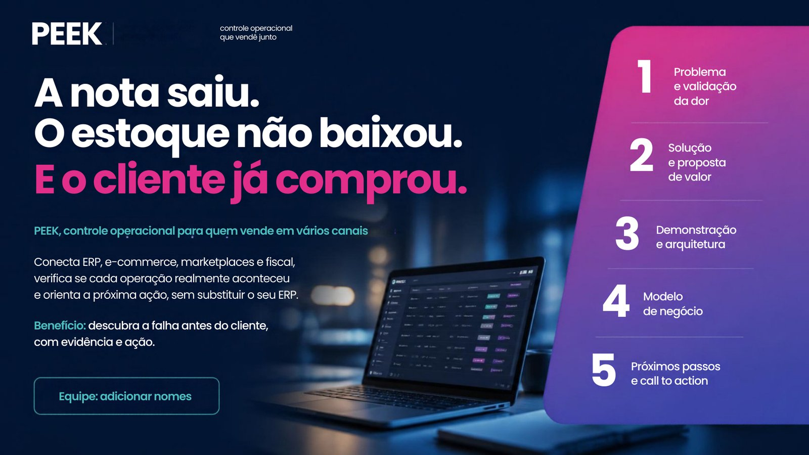
</p>

---

## O problema

**O problema é real e está nos números.** O desafio já não é entrar no digital, e sim manter a operação sob controle.

| Dado | O que significa | Fonte |
|:---:|---|---|
| **24 mi** | pequenos negócios ativos no Brasil | Sebrae, Radar Mercado Digital 2026 |
| **95%** | das empresas do país | Sebrae |
| **26,5%** | do PIB nacional | Sebrae |
| **59,2%** | das operações de e-commerce dos pequenos negócios são tocadas por uma só pessoa | Sebrae, Radar Mercado Digital 2026 |
| **> 50%** | dos vendedores online também têm loja física: o omnichannel já é realidade | Sebrae, Radar Mercado Digital 2026 |
| **+14,3%** | de novos pequenos negócios em 2026: 3,93 milhões abertos até agosto | Sebrae, jan. a ago./2026 |

**A dor na operação**

- Produto com vários códigos em sistemas diferentes
- Estoque desatualizado entre canais
- Nota fiscal fora do estoque
- Falhas descobertas tarde, só pelo cliente

> **Impacto no varejo:** R$ 36,5 bi em perdas em 2024 (Abrappe/KPMG) e ruptura em 42% das perdas de vendas (AGP/Abras).

---

## A solução

O PEEK é uma camada de controle sobre os sistemas que a empresa já usa. **Não substitui o ERP:** coordena, verifica e mostra quando algo saiu do esperado.

**Como funciona**

| | Etapa | O que faz |
|:---:|---|---|
| **1** | **Identidade** | Reconhece o mesmo produto entre ERP, canais e loja. |
| **2** | **Orquestração** | Solicita a sincronização de estoque e o fluxo fiscal. |
| **3** | **Verificação** | Confere se o resultado esperado realmente aconteceu. |

**Diferenciais**

- **Comprova o resultado:** não basta integrar; o PEEK confere se a sincronização e a nota fiscal realmente aconteceram.
- **Alerta que orienta:** evidências, causa provável e a próxima ação. A IA entra só onde há ambiguidade.
- **Sensibilidade para Libras:** pensado para incluir lojistas e equipes surdas, com alertas e orientações acessíveis em Libras.

<p align="center">
  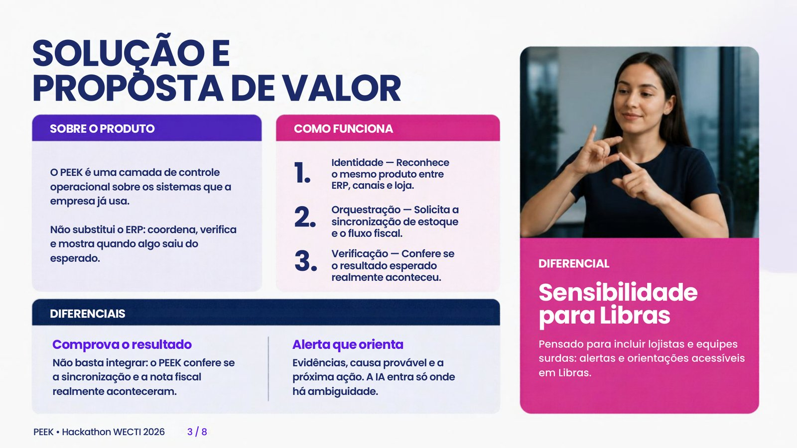
</p>

---

## Demonstração

O vídeo da demonstração mostra este fluxo:

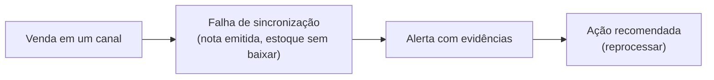

No hackathon, as fontes de dados são **simuladas**, seguindo o mesmo pipeline da arquitetura real.

---

## Arquitetura e stack

Os sistemas existentes (ERP, e-commerce, marketplaces, fiscal e estoque físico) enviam **eventos** ao PEEK, que devolve **comandos** de sincronização. Quando o resultado esperado não acontece, a divergência vira um alerta com evidências, causa provável e ação.

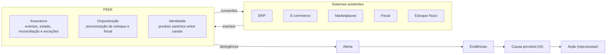

| Camada | Componente | Papel |
|:---:|---|---|
| **1** | **Adapters** | Traduzem ERP, canais e fiscal |
| **2** | **Event Engine** | Eventos canônicos e auditáveis |
| **3** | **PostgreSQL** | Estado esperado, do sistema e físico |
| **4** | **Reconciliação** | Regras determinísticas e quatro exceções |
| **5** | **IA do PEEK** | Causa provável e ação recomendada |
| **6** | **Central de Exceções** | Alerta, evidências e ação |

- **Reprocessar** gera uma nova tentativa e mantém o histórico da falha.
- **Base:** APIs, nuvem, automação e IA. Back-end em Java com Spring Boot, banco PostgreSQL e front-end em Next.js com TypeScript.

<p align="center">
  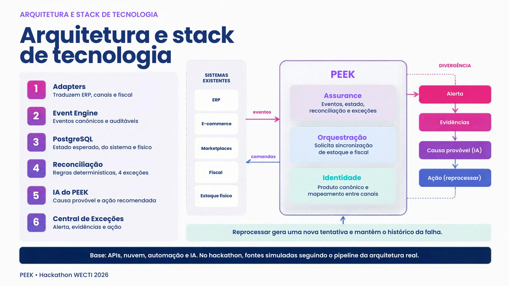
</p>

---

## Modelo de negócio

| Aquisição de usuário | Monetização | Público de partida |
|---|---|---|
| **Cold email:** mensagem direta a PMEs varejistas multicanal, com a dor concreta (nota emitida, estoque sem baixar). | **Consultoria e implantação** personalizadas, com base na empresa, como porta de entrada. | **PME varejista multicanal:** dono ou gestor que vende em loja, e-commerce e marketplaces. |
| **1. Consultoria com base na empresa:** diagnóstico de onde ERP, canais e fiscal divergem hoje. | **R$ 129,99 a R$ 329,99**, conforme o porte da empresa e a consultoria. | **24 milhões** de pequenos negócios ativos no Brasil (Sebrae, jul./2026). |
| **2. Implantação do PEEK:** conectado à operação do cliente, com alertas, evidências e ação recomendada. | | |

---

## Próximos passos

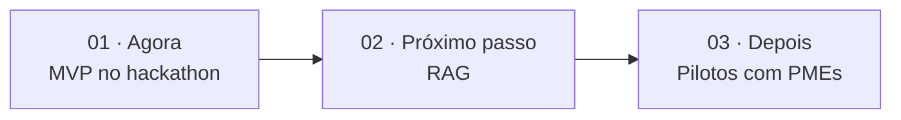

| Etapa | O que é |
|---|---|
| **01 · Agora** | MVP no hackathon: fontes simuladas, eventos canônicos, quatro exceções e Central de Exceções, com IA para causa e ação. |
| **02 · Próximo passo** | Incorporar RAG (embeddings e chunks) ao PEEK. |
| **03 · Depois** | Pilotos com PMEs: validar com lojistas reais, priorizar ERPs e canais e medir o ganho antes de prometer resultado. |

> **Vamos descobrir onde a sua operação falha?** Um diagnóstico com base na sua empresa mostra onde ERP, canais e fiscal divergem hoje.

---

## Apresentação

Os 8 slides do pitch estão em [`docs/PEEK_Hackathon_WECTI.pdf`](docs/PEEK_Hackathon_WECTI.pdf).

| | |
|:---:|:---:|
| <br><sub>1 · Capa</sub> | 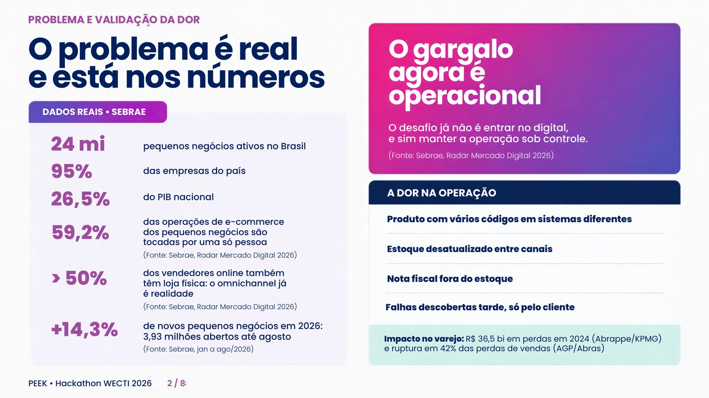<br><sub>2 · Problema e validação da dor</sub> |
| <br><sub>3 · Solução e proposta de valor</sub> | 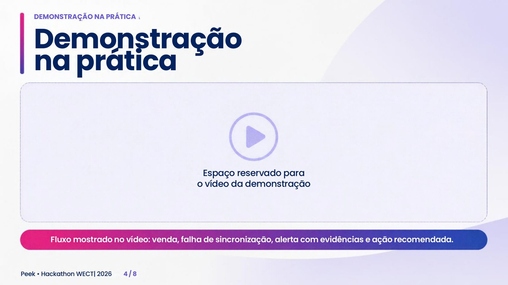<br><sub>4 · Demonstração na prática</sub> |
| <br><sub>5 · Arquitetura e stack</sub> | 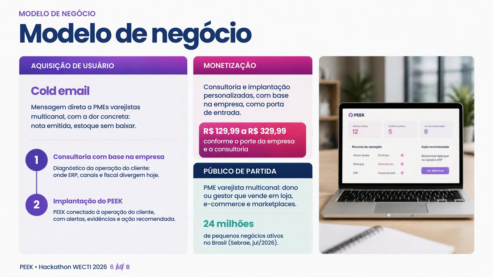<br><sub>6 · Modelo de negócio</sub> |
| 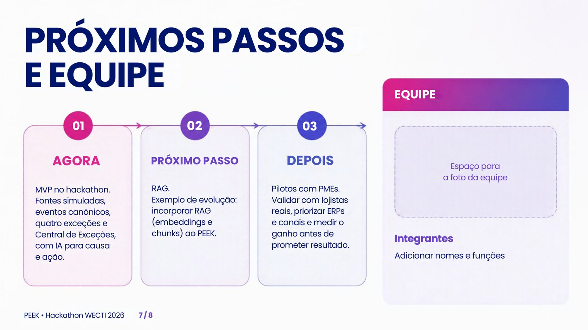<br><sub>7 · Próximos passos e equipe</sub> | 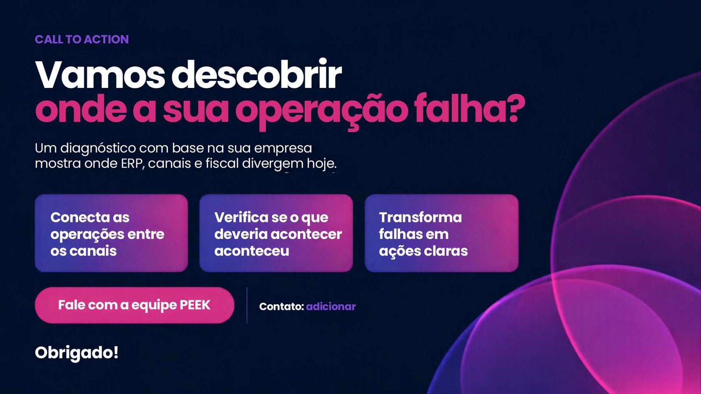<br><sub>8 · Call to action</sub> |

---

## Estrutura do repositório

```
.
├── docs/
│   └── PEEK_Hackathon_WECTI.pdf   ← apresentação do pitch (8 slides)
├── imagens/                       ← os slides em imagem, usados neste README
├── .github/
│   ├── capa.jpg                   ← capa deste README
│   ├── tests/repo.test.js         ← testes automáticos
│   └── workflows/ci.yml           ← roda os testes a cada push
└── README.md
```

**Testes automáticos** (Node 20 ou mais novo):

```bash
node --test .github/tests/*.test.js
```

Eles conferem se os links e as imagens do README existem e se a apresentação em PDF está no repositório.

---

## Código-fonte

O código do PEEK (back-end, front-end e banco de dados) fica no **repositório privado da equipe**. Este repositório reúne a apresentação e a documentação do projeto para o portfólio.

---

## Equipe

Integrantes em ordem alfabética:

| Integrante |
|---|
| Cauã Francisco Gomes da Silva |
| César Augusto Mechi Zanin |
| Henrique Novais de Oliveira |
| João Pedro Liberato de Oliveira |
| Júlio César Pereira da Silva |
| Marcus Vinicius dos Santos Cruz |
| Mateus Alves dos Santos |

---

<div align="center">

<sub>PEEK · Hackathon WECTI 2026 · Gestão da Tecnologia da Informação · UNICID 2026</sub>

</div>
